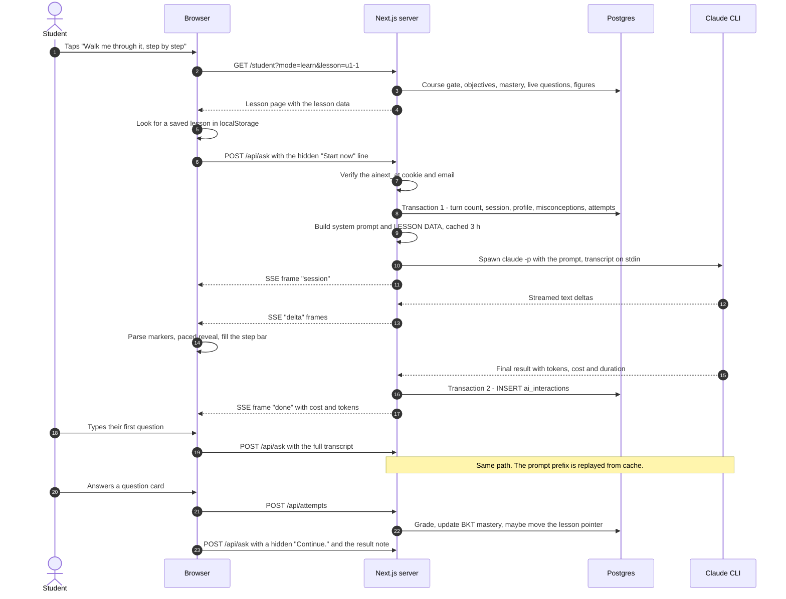
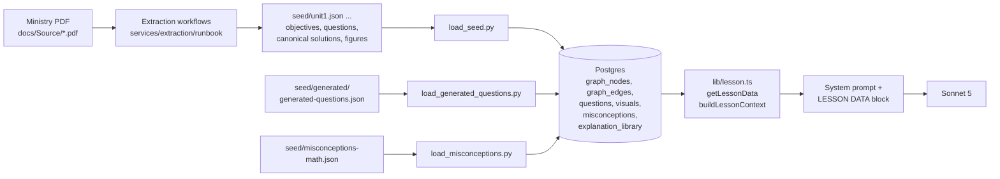

# Anatomy of a Tutor Turn

What happens, in order, from the moment a signed-in student opens a maths lesson to the moment the tutor answers the first question they type. Every step names the file that runs it and what to look at when it goes wrong.

*Traced from the source at v0.11.0 (2026-10-08), maths lesson, learn mode. Not verified on a running system. Rendered version: [`anatomy-of-a-tutor-turn.html`](anatomy-of-a-tutor-turn.html). The exact prompt text: [`real-tutor-prompt.md`](real-tutor-prompt.md).*

| | |
|---|---|
| Model | `claude-sonnet-5`, via the `claude` CLI |
| Turns and tools | `--max-turns 1`, `--disallowedTools "*"` |
| Timeout | 90 s, then the process is killed |
| Thinking | 1,024 tokens per reply (default) |
| Transactions | 2, none held open while the model writes |

Each step below is tagged with where it runs: **[browser]** the student's iPad, **[server]** Next.js, **[db]** Postgres under row-level security, **[model]** the Claude CLI.

## The whole flow

Four actors. The tutor speaks first: the browser sends a hidden "start the lesson" message as soon as the lesson opens, so the student's typed question is really the second call to `/api/ask`.



## Where the content comes from

Nothing the tutor teaches is invented at request time. The book was digested earlier into JSON, loaded into Postgres, and read back into the prompt on every lesson.



- Book questions load as `live`. Generated variants load as `review` unless the loader is run with `--promote`, so only promoted variants reach the prompt.
- Only `questions.status = 'live'` rows are read. Each carries its human-reviewed canonical solution, which the tutor must follow step for step.
- Maths lessons have no teaching script and no content bundle. Those exist for Arabic and Social Studies only (`seed/content/*.json`).

## Step by step

Read it like a debugger stepping through. The numbering is the real execution order.

### Phase A · Already signed in

1. **The browser holds two cookies** [browser]
   `ainext_at` is the access token: a signed JWT, HttpOnly, valid for 15 minutes, sent with every request. `ainext_rt` is the refresh token, sent only to `/api/auth/*`. Page code can read neither.
   *Where:* `lib/auth/cookies.ts:73-104`, `lib/auth/tokens.ts:42`
   *Check:* DevTools → Application → Cookies. No `ainext_at` means every page redirects to `/signin`.

2. **The session renews itself** [browser]
   Every request goes through `authFetch`. On a 401 it calls `POST /api/auth/refresh` once and retries. A keep-alive also renews every 10 minutes while the page is visible and the student is active. Only one tab renews at a time, because reusing a refresh token is treated as theft and revokes every session.
   *Where:* `lib/auth/client-session.ts:101-198`, `components/auth/SessionKeepAlive.tsx`

### Phase B · Opening the lesson

3. **Student taps "Walk me through it, step by step"** [browser]
   A client-side navigation to `/student?mode=learn&lesson=<slug>`, for example `u1-1`.
   *Where:* `components/student/LessonCheckIn.tsx:393-398`

4. **The page loads the lesson** [server]
   The server component resolves the student, then calls `getLessonData` and renders `<LessonSession mode="learn">`.
   *Where:* `app/(student)/student/page.tsx:96-111`

5. **Lesson data is read, course gate first** [db]
   One student-scoped connection, in order:
   - **Objectives:** `graph_nodes` / `graph_edges`, ids like `lo:u1-1-%`, in teaching order.
   - **Course gate:** if this student's grade can't see the course, the page is a 404 and nothing else is read.
   - **Mastery:** `mastery`, the current BKT score per objective.
   - **Questions:** `questions WHERE status='live'`, including answers and canonical solutions.
   - **Figures:** `visuals`.

   *Where:* `lib/lesson.ts:327-501`, `lib/catalog-queries.ts:84-93`
   *Check:* a 404 here, or later `{"error":"not_found"}` from `/api/ask`, means the course gate refused (migration 023, `course_availability`, `student_course_access`).

### Phase C · The lesson screen mounts

6. **Resume check** [browser]
   Reads `ainext-lesson:learn:<slug>:s<studentId>`. A valid save shows "Continue the lesson?". Otherwise the lesson starts fresh with a new session id from `crypto.randomUUID()`. On `main` the save lives in `sessionStorage`. On the `fix/FR-204-finish-keeps-place` branch it moves to `localStorage` with a 7-day limit.
   *Where:* `components/student/LessonSession.tsx:352-388`

7. **The hidden first message is chosen** [browser]
   The student's mastery decides the opening. At stage 0 (nothing mastered yet) the browser will send, as if the student had typed it:
   ```text
   Start now. This is a brand-new lesson for me — I haven't seen it before. Let's dive in!
   ```
   The student sees only the local line "Let's go 💪 setting up today's lesson… ✏️".
   *Where:* `lib/checkin.ts:154-165`, `LessonSession.tsx:145-149`

8. **ChatCore sends it to `/api/ask`** [browser]
   A GA event `question_asked` fires for every send, hidden ones included. The request body:
   ```json
   {
     "surface": "lesson_learn",
     "chatSession": "3f2c…-uuid",
     "lesson": "u1-1",
     "messages": [
       { "role": "user", "text": "Start now. This is a brand-new lesson for me…" }
     ]
   }
   ```
   *Where:* `components/chat/ChatCore.tsx:617-800`

### Phase D · The server prepares the call

9. **Validate the body** [server]
   Bad JSON → 400. The surface is whitelisted. Only the last 24 messages are kept. No `chatSession` or no user message → 400. There are no turn caps (ADR-0023): the route never refuses a reply for count.
   *Where:* `app/api/ask/route.ts:151-190`

10. **Who is asking** [server]
    Verifies the `ainext_at` JWT, then one query checks that the session isn't revoked or expired and the account isn't disabled. Not a student → `401 unauthenticated`. Email not confirmed → `403 email_unverified`.
    *Where:* `lib/auth/principal.ts:71-149`, `route.ts:195-206`

11. **Transaction 1 opens under the student's identity** [db]
    `BEGIN`, then `set_config('app.student_id', …)`. From here row-level security means every query sees this student's rows only.
    *Where:* `lib/db.ts:116-141`, `route.ts:218`

12. **Count earlier turns** [db]
    ```sql
    SELECT count(*) FROM ai_interactions
     WHERE surface = 'lesson_learn' AND grounding->>'chat_session' = $2 AND student_id = $3
    ```
    The answer plus one becomes this turn's `turn_index`.
    *Where:* `route.ts:223-229`

13. **Open or reuse the learning session** [db]
    One open session per student. A session idle for 30 minutes is closed as `inactivity`, a different kind is closed as `superseded`, otherwise it is reused. A new session stores the release tag and whether Socratic probing is on. Probing applies only to English maths in learn mode, and only for marked test accounts while "Everyone" is locked.
    *Where:* `lib/sessions.ts:350-469`, `lib/session-rules.ts:72-83`, `lib/socratic-probing.ts:155-165`
    *Check:* console → Students → Sessions shows each sitting and why it ended. If this step errors, the turn still goes ahead with `session_id = NULL`.

14. **Read the student profile** [db]
    Name, grade, interests, language, gender. Read fresh on every turn, never cached.
    *Where:* `lib/student-context.ts:196-225`

15. **Prompt cache lookup** [server]
    The key is session + student + lesson + upload + how the student is addressed (+ probing). On a hit the exact same prompt bytes are replayed, so the model provider's prompt cache stays warm. It lives in server memory: 3 hours, 200 sessions, and it is lost on restart.
    *Where:* `lib/session-cache.ts:56-124`, `route.ts:275-310`

16. **On a miss: build the lesson context** [db]
    Re-reads the lesson data (step 5), then the extras that shape teaching:
    - `misconceptions` and `explanation_library` for these objectives.
    - Nearest skills: these objectives and their prerequisites, weakest first, top 5.
    - The last 12 attempts, which set the engagement stance.
    - The parsed text of an uploaded photo, if one is attached (capped at 4,000 characters).

    *Where:* `lib/lesson.ts:1173-1275`, `lib/retrieval.ts:153-319`

17. **Assemble the prompt** [server]
    System prompt = tutoring rules + the LESSON DATA block (both stable, so they can be cached). The user message = the transcript. See [What the model is told](#what-the-model-is-told).
    *Where:* `lib/lesson.ts:1021-1066, 541-585`, `route.ts:354-382`

18. **Transaction 1 commits** [db]
    No database connection is held while the model writes, which can take tens of seconds. If anything above threw, the reply is `500 internal error` and nothing is streamed.
    *Where:* `route.ts:318-337`

### Phase E · The model call

19. **First stream frame goes out** [server]
    The response is Server-Sent Events. The first frame tells the browser whether this sitting probes: `data: {"type":"session","probing":false}`
    *Where:* `route.ts:413`

20. **The CLI is spawned** [model]
    ```sh
    claude -p --output-format stream-json --include-partial-messages --verbose \
      --model claude-sonnet-5 --system-prompt "<rules + LESSON DATA>" \
      --disallowedTools "*" --max-turns 1
    # env: MAX_THINKING_TOKENS=1024   cwd: $TMPDIR   stdin: the transcript
    ```
    Signed in with the subscription login in `CLAUDE_CONFIG_DIR`, not an API key. The working directory is the temp folder so no project instructions leak into the tutor.
    *Where:* `route.ts:415-467`, `lib/claude-cli.ts:63-104`
    *Check:* `docker exec <app> claude -p "hi"`. If that fails, every tutor turn fails.

21. **Text streams back** [model]
    Each `text_delta` line from the CLI is forwarded at once as `data: {"type":"delta","t":"…"}`. Token usage is collected as it arrives. After 90 seconds, or if the student leaves the page, the process is killed.
    *Where:* `route.ts:499-611`

22. **The sacred-text guard watches** [server]
    Every reply is checked against the sealed Quran and Hadith passages, 4 words at a time. When that content exists, the last 96 characters are held back until the end. It matters for Arabic lessons; on a maths reply it only adds a short delay at the very end.
    *Where:* `lib/sacred-guard.ts:21-26`, `route.ts:348-350, 550-603`

### Phase F · The browser renders the reply

23. **Read the stream** [browser]
    Splits on blank lines, parses each `data:` line and appends `delta` text to the tutor's bubble.
    *Where:* `ChatCore.tsx:810-866`

24. **Parse the markers** [browser]
    `[[lo:…]]`, `[[q:…]]` and `[[page:N]]` become small citation chips. `{{beat}}` becomes a pause. `{{show_question:…}}` becomes a question card, `{{widget:…}}` an interactive widget. Half-written markers and unclosed `$…$` maths are hidden until complete.
    *Where:* `lib/chat-parse.ts:80-461`, `components/chat/message-blocks.tsx:184-254`

25. **Paced "writing" reveal** [browser]
    About 3 words every 850 ms (≈200 words a minute), 1.15 s pause after a sentence, 1.7 s at a `{{beat}}`, 1.5 s after a card or widget. Directives appear whole. Turned off for students who prefer reduced motion.
    *Where:* `ChatCore.tsx:245-254, 688-763`

26. **The step bar fills** [browser]
    The first time the tutor cites `[[lo:X]]` for one of this lesson's objectives, that objective counts as covered and the "2 of 4" bar moves.
    *Where:* `ChatCore.tsx:566-615`, `LessonSession.tsx:1020-1027`

### Phase G · After the reply

27. **Transaction 2: the ledger row** [db]
    Every turn writes one `ai_interactions` row, including failures. It holds tokens (uncached input, output, cache reads and writes), cost at list price, latency, the objectives and questions in the prompt (`grounding`), the citations the reply used, environment, session and release tag, and the outcome: `ok`, `error`, `timeout` or `redacted`.
    *Where:* `route.ts:634-810`, `lib/pricing.ts:213-226`

28. **The last frame** [server]
    ```text
    data: {"type":"done","meta":{"costUsd":0.0112,"inputTokens":412,"outputTokens":186,
      "cacheReadTokens":7930,"cacheCreationTokens":0,"latencyMs":6400,
      "model":"claude-sonnet-5","interactionId":5531,"turnIndex":1}}
    ```
    The numbers above are illustrative. On failure the last frame is instead `{"type":"error","message":"AI backend unavailable — please try again"}`.
    *Where:* `route.ts:796-809`

29. **The transcript is saved** [browser]
    At most once every 900 ms, so a reload can offer "Continue where I left off".
    *Where:* `LessonSession.tsx:465-509`

### Phase H · The student types their first question

30. **Same path, longer transcript** [browser]
    The bubble appears, then `POST /api/ask` with the same `chatSession`. `messages` now holds the hidden start line, the tutor's first reply, any result notes, and the new question. Steps 9 to 29 repeat. The difference is that step 15 is a cache hit: the system prompt is replayed byte for byte, so most input tokens are cache reads.
    *Where:* `ChatCore.tsx:1321-1333`

31. **What the model actually receives** [model]
    ```text
    CONVERSATION SO FAR:
    User: Start now. This is a brand-new lesson for me — I haven't seen it before. Let's dive in!

    Tutor: Salma! New topic today — ordered pairs 🚀 …

    User: why does the order matter?

    Reply as the Tutor to the last user message. Output only the reply text
    (with citation markers and, if fitting, one action directive).
    ```
    *Where:* `route.ts:354-382`

### Phase I · If they answer a question card

32. **Submit the attempt** [browser]
    ```text
    POST /api/attempts
    { "questionId": "q:u1-1-1:001", "givenAnswer": "D", "timeMs": 14200 }
    ```
    *Where:* `components/chat/ChatQuestionCard.tsx:100-133`, `lib/attempts-client.ts:11-39`

33. **Grade and update mastery** [db]
    The server grades the answer, runs a BKT (Bayesian Knowledge Tracing) update on that objective's mastery, can diagnose a known misconception, and moves the lesson pointer if the objective is now mastered. It returns `isCorrect`, `correctAnswer`, the solution steps, old and new scores, and any diagnosis.
    *Where:* `app/api/attempts/route.ts:369-450, 599-630`

34. **The tutor is told, invisibly** [browser]
    The browser adds a hidden note and, 700 ms later, sends a hidden "Continue." so the tutor reacts:
    ```text
    [live event] ✗ the student answered q:u1-1-1:001 incorrectly (correct answer: A) — still not started → still not started (for you only: never say the band…)
    ```
    Mastery reaches the model only as a word band, never a number.
    *Where:* `ChatCore.tsx:1001-1102, 974-987`

## What the model is told

The system prompt for an English maths lesson in learn mode, in order. The full captured text is in [`real-tutor-prompt.md`](real-tutor-prompt.md).

**Tutoring rules** (`lib/lesson.ts:1021-1066`)

| Section | Content |
|---|---|
| Identity and premise | "You are Salma's personal AI tutor at Noor. She is an Egyptian grade-9 (prep-3) student who just came home from school. Today's lesson is 1-1 — Cartesian product…" The premise changes with mastery stage: brand-new, round two, more depth, or go deeper. |
| Tone | Upbeat, playful and curious, never clinical. |
| Hard grounding rules | Teach only this lesson's objectives, in order. Every mathematical claim must follow from the objective descriptions and canonical solutions. Follow a canonical solution's steps exactly and never change a final answer. |
| Language and voice | English throughout, even if the student writes in Arabic. Warm private tutor, never lecturing. Never say "LO" to the student. |
| Lesson arc | One-line greeting, then each objective in 2–3 messages (the last in 1–2), then a final recall question from memory, then a recap with `{{finish_lesson}}`. |
| Citations | `[[lo:…]]`, `[[q:…]]`, `[[page:N]]` after substantive claims, ids only from the lesson data, never inside maths. |
| Message rhythm | 2–4 beats per message, each at most 2 short sentences (≤25 words). The last beat is always an ask. Never state a step before asking the student to try it. Ask for the working at least once per objective. Wrong answer: re-explain that exact point another way, grounded in the canonical steps, without leading with the correct letter. |
| Socratic probing | Only when probing is on: guide with one question instead of revealing; grade a typed answer with `{{answer_submitted:X}}`; reveal only after the second wrong attempt. |
| Interactive directives | At most one per message, always last: a question card, one of this unit's widgets, a figure, or `{{finish_lesson}}`. |
| Cross-subject and format | A history or geography question gets one line and a hand-off card, never an answer from memory. Plain short paragraphs, maths in `$…$`, no headings or walls of text. |

**LESSON DATA** (`lib/lesson.ts:541-585` + `lib/retrieval.ts:229-319`)

| Section | Content |
|---|---|
| Header | "LESSON DATA — your ONLY source of truth (school 1-1: Cartesian product — Unit 1, Egyptian ministry textbook)" |
| Objectives | `- lo:u1-1-1 \| "Ordered pairs and their equality" \| book p.7 \| still developing` plus the description. Bands only, never percentages. |
| Question bank | Each live question: id, tier, type, page, stem, choices, correct answer, and "CANONICAL SOLUTION (v1, human-reviewed): Step 1. … \| Step 2. …". |
| Figure library | `- v:u1-1:001 \| coordinate_plot \| lo:u1-1-1 \| p.7 \| "caption"` |
| How to address the student | Name and pronouns (she/her, he/him, or singular they when unknown — never masculine by default). Changes sentence form only, never content. |
| Student model | Grade, language, interests. "If no interest is listed, do NOT frame explanations around an invented interest." |
| Engagement and nearest skills | A stance from the last 12 attempts, and the 5 weakest related skills as bands. |
| Misconceptions and library | Known mistakes for these objectives and their authored refutations: "teach FROM these — never improvise a refutation". |
| Uploaded work | The parsed text of the student's photo or PDF, if attached, up to 4,000 characters. |

To see a real rendered prompt from a live database: `npm run capture:prompts -- <outDir>` in `app/`. Rendered reference prompts for a small test lesson are in `app/src/lib/probing-prompts.golden.json`.

## How it replies

Short, paced, and always ending on something for the student to do. The first reply is not a lecture with a worked example: the rhythm rules forbid showing a step before asking the student to try it.

What the model writes (illustrative, built from real ids in `seed/unit1.json`):

```text
Exactly — swap the order and you get a
different pair [[lo:u1-1-1]].
{{beat}}
So two pairs are equal only when BOTH
slots match. Try this one 👇
{{beat}}
{{show_question:q:u1-1-1:001}}
```

What the student sees: two short paragraphs appearing in turn, a citation chip "Ordered pairs" after the first, then a question card — "If (a, 5) = (3, b), then a + b = ?" with choices A · 8, B · 15, C · 2, D · 35 — and under the chat the two fixed chips "I don't get it — say it another way" and "Got it — next ✓".

| Marker | What the student gets | Notes |
|---|---|---|
| `[[lo:…]]` `[[q:…]]` `[[page:N]]` | A small citation chip | Also fills the step bar (lo only) and is logged to `ai_interactions.citations` |
| `{{beat}}` | A 1.7 s writing pause | Prints nothing |
| `{{show_question:q:…}}` | A question card | Graded on the server by `/api/attempts`, updates mastery |
| `{{widget:name:{…}}}` | A hands-on maths widget | Only this unit's widgets. Graded on the device, result sent back as a live event |
| `{{widget:viz_ref:v:…}}` | A stored, curated figure | Fetched from `/api/visuals` |
| `{{finish_lesson}}` | Finish button lights up, plus a chip | Does not end the chat; tapping Finish starts the report |
| `{{answer_submitted:X}}` | Nothing visible | Probing only: grades the student's typed answer on the open card |
| `{{switch_subject:social}}` | A hand-off card | For a question from the other subject |

The two chips under the chat are fixed in the app, not written by the model.

## Wire formats

Stream frames, in order (`text/event-stream`):

```text
data: {"type":"session","probing":false}

data: {"type":"delta","t":"Salma! New topic "}

data: {"type":"delta","t":"today — ordered pairs"}

…

data: {"type":"done","meta":{…}}
```

Plain JSON errors, before any streaming:

| Status | Body | Meaning |
|---|---|---|
| 400 | `invalid JSON` | Malformed body or no user message |
| 401 | `unauthenticated` | No valid cookie after one refresh |
| 403 | `email_unverified` | Email not confirmed |
| 404 | `not_found` | Course gate refused this lesson |
| 500 | `internal error` | Transaction 1 threw |

## Debugging guide

Start from what the student saw, then follow the row.

| Symptom | Look at | Likely cause |
|---|---|---|
| "You have been signed out" | DevTools → Network: `/api/ask` 401, then `/api/auth/refresh` | Refresh token expired or revoked; sign in again |
| "AI backend unavailable — please try again" | App logs; the newest `ai_interactions` row: `outcome` and `assistant_message` | `[no answer — …: not_signed_in]` means the CLI login is gone; `timed_out` is the 90 s limit; `cli_missing` means `claude` isn't on PATH |
| Thinking dots forever | Network → `/api/ask` → EventStream tab | No `delta` frames: the CLI hasn't produced text yet, or a proxy is buffering the stream |
| Lesson shows 404 | `course_availability`, `student_course_access` | The course isn't visible for this student's grade |
| Tutor teaches the wrong thing | `ai_interactions.grounding` (which objectives and questions it was given), `citations` (what it used) | Wrong or missing live questions for the lesson; check `questions.status` |
| Reply shows raw `{{…}}` | `lib/chat-parse.ts` | A malformed directive (bad JSON in a widget) the parser could not match |
| Want to see cost and tokens | Triple-tap the lesson header | Turns on debug mode: per-message cost, tokens, and the hidden live-event notes |
| Want the whole sitting | Console → Students → a student → Sessions | Every turn with its reply, grounding and cost |

```sql
-- the last 5 tutor turns for one student
SELECT id, created_at, turn_index, outcome, latency_ms, cost_usd,
       input_tokens, cache_read_tokens, output_tokens,
       grounding->>'chat_session' AS chat, citations, left(assistant_message, 120)
  FROM ai_interactions
 WHERE student_id = 7 AND surface = 'lesson_learn'
 ORDER BY id DESC LIMIT 5;
```

## Knobs

| Setting | Value | Where |
|---|---|---|
| Model | `claude-sonnet-5` | `app/api/ask/route.ts:107` |
| Timeout | 90 s, then killed | `route.ts:108` |
| Thinking budget | 1,024 tokens; `0` or `off` disables | `AINEXT_THINKING_BUDGET` |
| Conversation window | last 24 messages | `route.ts:183` |
| Prompt cache | 3 h, 200 sessions, in memory | `lib/session-cache.ts` |
| Session idle close | 30 min | `lib/session-rules.ts:28` |
| Upload text in prompt | 4,000 characters | `lib/retrieval.ts:307` |
| Reveal speed | 3 words / 850 ms | `ChatCore.tsx:245-254` |
| Socratic probing | Off / Test accounts / Everyone (locked) | Console → Teaching |
| Database pool | 20 connections | `lib/db.ts:86` |

> **Cost is imputed, not billed.** The tutor runs on a Claude subscription login, so `cost_usd` is the list price the tokens would have cost (Sonnet 5: $2 per million input, $10 per million output, $0.20 per million cache reads). It is for watching spend per student, not an invoice.

> **Not verified live.** This page is traced from the source code, not from a running system. The prompt sizes are estimates, and whether the CLI's prompt caching actually hits is inferred from the stored cache-token columns. One real `ai_interactions` row and one `capture:prompts` run would confirm both.
